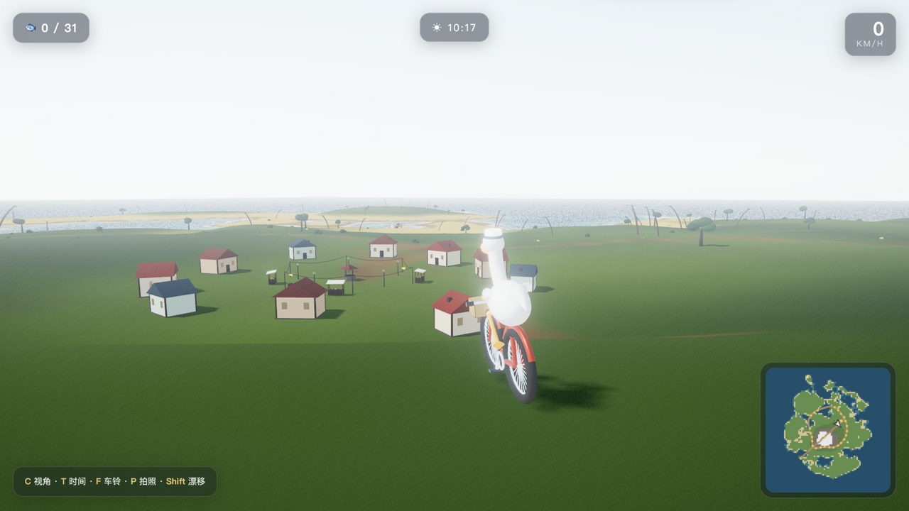
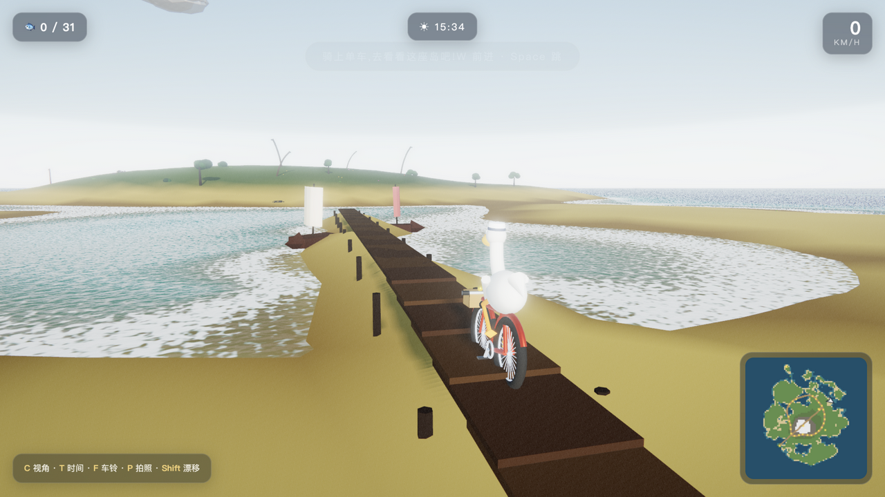
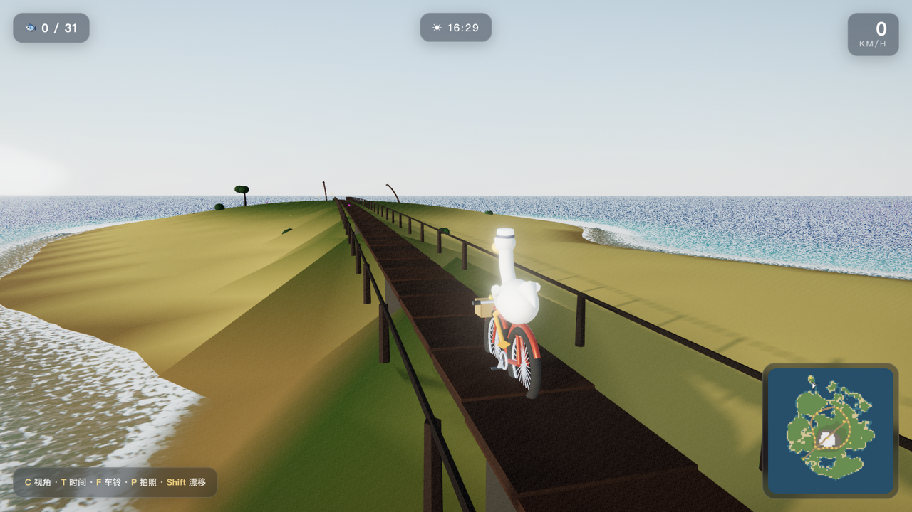
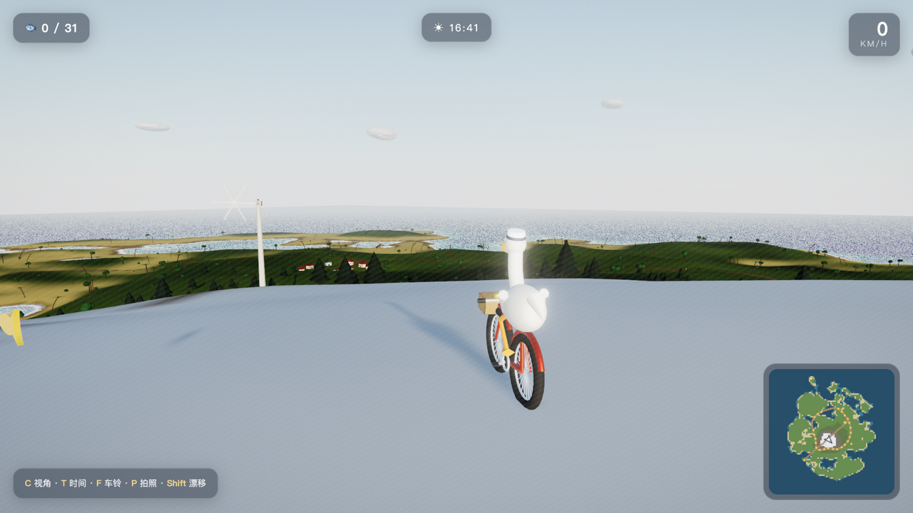

# 鹈鹕环岛记 · Pelican Isle Ride

> 🚴 **[▶ 点这里直接试玩](https://bayshier.github.io/pelican-isle/)** —— 打开即玩,无需安装(WebGL2 浏览器即可,建议 Chrome/Edge/Safari 桌面版)

一只戴水手帽的鹈鹕,骑一辆红色自行车,在半径约一公里的程序化热带岛屿上自由骑行。
**纯 Three.js(r160)手写,约 2800 行代码,零模型 / 零贴图 / 零音频文件**——你看到的一切,都是代码在浏览器里现场"长"出来的。

| | |
| --- | --- |
|  |  |
| *渔火村:10 栋小屋、串灯、市集,入夜窗火渐亮* | *观海栈桥:帆船随浪,沙滩篝火* |
|  |  |
| *跨海大桥:317 米,骑去离岛「鹈鹕岩」* | *主峰雪线之上,整座岛尽收眼底* |

## 它是一座什么样的岛

- **环岛公路 + 支路**,穿村庄、上山岗、绕海角,路面和草地抓地力不同
- **渔火村**:10 栋小屋、水井、市集摊、广场串灯——入夜窗火一盏盏亮起
- **灯塔海角**:红白灯塔,夜间双光束旋转扫海
- **主峰**(雪线观景台)与山坡上三台旋转的风力发电机、山岗荷兰风车
- **观海栈桥**与随浪摇的帆船、沙滩篝火
- **317 米跨海大桥**,通向离岛「鹈鹕岩」
- 两只热气球环岛漂、海鸥编队、蝴蝶(白天)、萤火虫(夜里)
- **15 分钟一整天的昼夜循环**:晨光、正午、金色黄昏、星空与月光
- 40 条金色小鱼散落全岛,车筐会真的被装满

## 操作

| 按键 | 功能 |
| --- | --- |
| W / ↑ · S / ↓ | 骑行 / 刹车 |
| A D / ← → | 转向 |
| Shift | 漂移(扬尘) |
| Space | 小跳 |
| C | 视角:追尾 → 电影低机位 → 环绕(拖拽旋转/滚轮缩放) |
| T | 时间流速:1× → 40× → 暂停(用 40× 看日落!) |
| F | 车铃 |
| M / P | 小地图 / 拍照模式(黑边+纯净画面) |
| R / N | 回村 / 静音 |

## 本地运行

```bash
git clone https://github.com/bayshier/pelican-isle.git
cd pelican-isle
node server.js        # 或任意静态服务器
# 打开 http://localhost:8642
```

Three.js 已精简打包在 `libs/three/`(1.8MB),离线可跑,无 npm install。

## 它是怎么做的(技术速览)

- **一个高度函数统治全岛**:`terrainHeight(x, z)` 纯函数(simplex 噪声域扭曲海岸线 + 掩膜 + 主峰/离岛高斯 + 台地 + 桥面走廊),地形网格、植被散布、建筑地基、骑行物理、桥面全部查它——所以跨海大桥直接"写"进高度场,车轮天然贴桥。
- **自定义海面 shader**:双层滚动程序化法线、菲涅尔映天空、太阳/月亮高光;岸边泡沫和浅滩透明来自一张烘焙高度图(`DataTexture`),离岸自动渐隐。
- **昼夜 = 一份调色板**:按太阳高度角插值的 5 个关键帧,同时驱动雾色、水色、阳光和半球光;Sky 物理天空 + PMREM 环境光每 2.5 秒重生;阴影相机跟随玩家保证近处影子清晰。
- **6000+ 植被全是 InstancedMesh**:顶点色 + `aSway` 属性,`onBeforeCompile` 注入风摆;建筑同理,窗户单独实例化,夜晚一行代码全村亮灯。
- **鹈鹕蹬腿 = 双骨 IK**:踏板位置由曲柄角解析算出,膝关节平面圆交求解,骨骼用 `setSegment` 摆放;翅膀搭在车把上随转向摆动,压弯人和车一起倾。
- **电影感后期**:HalfFloat MSAA → UnrealBloom(线性 HDR 下阈值必须 >1,第一坑)→ 暗角/色差/颗粒 → ACES 输出。
- **音频零文件**:WebAudio 合成风(随车速)、浪(随离岸距离)、车铃与收集音。

完整工程细节与**可投喂给任何模型的复刻提示词**见 📐 [REBUILD_SPEC.md](REBUILD_SPEC.md)。

## 图文实录

写作背景与完整故事(这道题的前传:9 个国产模型画"鹈鹕骑自行车"横评):
[鹈鹕骑自行车测试:9 个国产模型横评](https://bayshier.github.io/GYZApp/blog-pelican-bicycle.html#七续作202610把考题做成世界鹈鹕环岛记)

## License

MIT
